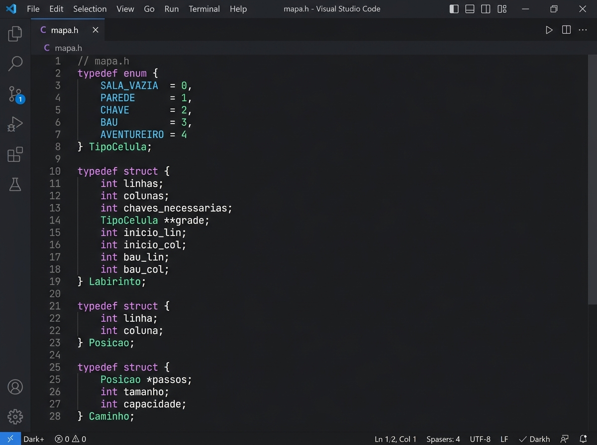
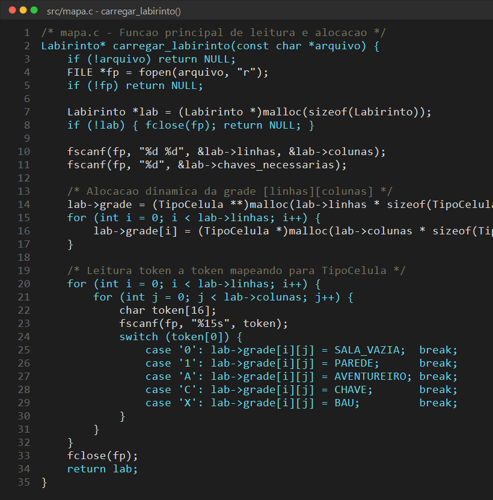
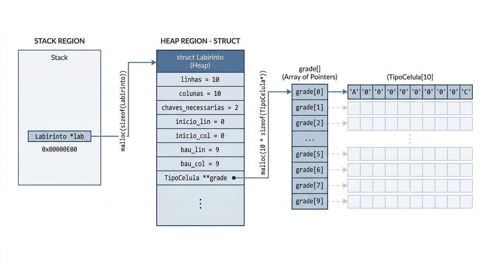
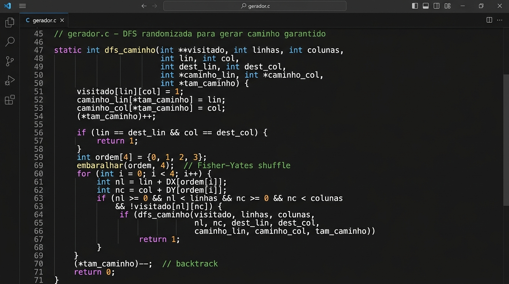
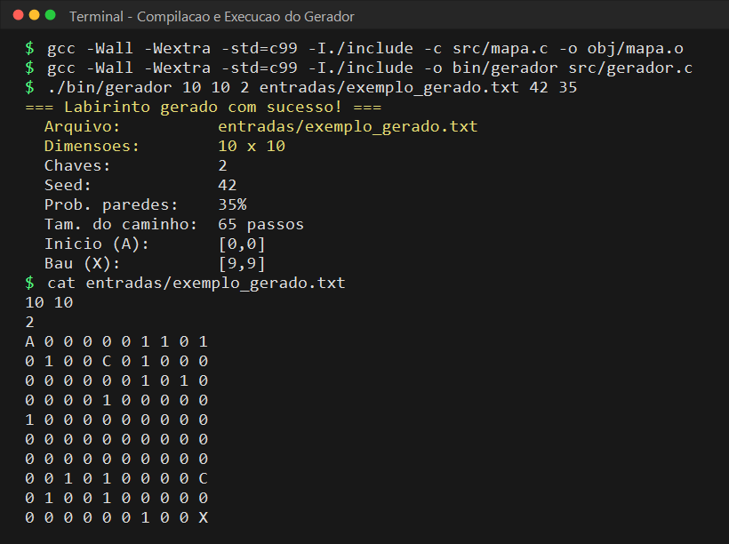

# Capítulo 1 — Gerenciamento de Memória do Mapa e Algoritmo Gerador em C

> **Disciplina:** Projeto e Análise de Algoritmos — UFV Florestal  
> **Professor:** Daniel Mendes Barbosa  
> **Trabalho Prático 1**  
> **Integrante responsável por este capítulo:** [SEU NOME] — Matrícula: [SEU NÚMERO]

---

## Sumário do Capítulo

1. Introdução
2. Módulo do Mapa (mapa.c / mapa.h)
   - 2.1 Estruturas de dados fundamentais
   - 2.2 Carregamento e validação da entrada (carregar_labirinto)
   - 2.3 Gerenciamento e layout de memória na Heap
   - 2.4 Vetor dinâmico para registro do caminho
3. Gerador de Mapas Solúveis (gerador.c — Extra 1)
   - 3.1 Abordagem e garantia formal de solução viável
   - 3.2 DFS randomizada com embaralhamento de Fisher-Yates
   - 3.3 Posicionamento protegido de chaves e paredes
   - 3.4 Compilação e execução via linha de comando
4. Decisões de implementação
5. O que funciona e o que não funciona
6. Conclusão
7. Referências

---

## 1. Introdução

Este capítulo documenta a concepção e implementação do módulo de mapa (`mapa.c` e `mapa.h`) e do gerador de labirintos (`gerador.c`), componentes que integram a primeira parte do trabalho prático.

O módulo de mapa é a fundação de todo o sistema: ele define os tipos primitivos que todos os outros quatro módulos utilizam (`Labirinto`, `TipoCelula`, `Posicao`, `Caminho`), realiza a leitura e validação sintática do arquivo `.txt`, aloca a matriz dinamicamente na heap e fornece funções utilitárias seguras para controle de visitados e passos do aventureiro.

Em adição ao requisito base, foi desenvolvido o programa independente `gerador.c` (referente ao **Extra 1** da especificação). O gerador permite criar labirintos arbitrários em 100% C padrão (C99), recebendo dimensões, quantidade de chaves, densidade de obstáculos e semente aleatória, garantindo matematicamente que todo mapa gerado possua ao menos um trajeto válido até o baú com todas as chaves requeridas.

---

## 2. Módulo do Mapa (mapa.c / mapa.h)

### 2.1 Estruturas de dados fundamentais

Como a especificação proíbe bibliotecas externas ou scripts auxiliares, todas as entidades necessárias para representar o estado do labirinto e o histórico do aventureiro foram projetadas do zero no arquivo de cabeçalho `mapa.h`.



A representação é composta por três estruturas centrais:

1. **TipoCelula**: Tipo enumerado que atribui significado semântico direto a cada caractere do arquivo (`SALA_VAZIA = 0`, `PAREDE = 1`, `CHAVE = 2`, `BAU = 3`, `AVENTUREIRO = 4`). O uso da enumeração torna o código autoexplicativo e evita o uso de números mágicos espalhados pela lógica de busca.
2. **Labirinto**: Armazena as dimensões (`linhas`, `colunas`), a meta de chaves (`chaves_necessarias`), as coordenadas pré-indexadas de início `(inicio_lin, inicio_col)` e de destino `(bau_lin, bau_col)`, além do ponteiro duplo `grade` apontando para a matriz alocada dinamicamente. Guardar as posições de `A` e `X` durante o parseamento elimina a necessidade de buscas lineares subsequentes na matriz.
3. **Caminho**: Estrutura de vetor dinâmico contendo um ponteiro para um array de `Posicao`, um contador `tamanho` e a `capacidade` total alocada. Esse vetor cresce dinamicamente sob demanda conforme o algoritmo de backtracking explora novas salas.

---

### 2.2 Carregamento e validação da entrada (carregar_labirinto)

A função `carregar_labirinto(const char *arquivo)` é a porta de entrada dos dados. Sua implementação prioriza robustez e falha segura: se qualquer inconsistência for detectada no arquivo de texto, toda a memória previamente alocada é liberada antes de retornar `NULL`.



O fluxo de processamento segue etapas bem definidas:
- **Abertura e Validação de Cabeçalho**: Lê as duas dimensões e a quantidade de chaves esperadas com `fscanf`. Rejeita imediatamente dimensões nulas, negativas ou arquivos corrompidos.
- **Alocação Bidimensional**: Aloca o vetor de ponteiros para as linhas e, em seguida, cada vetor de células individualmente. Se uma alocação intermediária falhar, o laço de reversão limpa as linhas anteriores antes de abortar.
- **Parse Célula a Célula**: Lê token por token (tratando espaços, quebras de linha e tabulações de forma transparente). Durante a leitura, converte os símbolos para `TipoCelula` e garante que exista exatamente um ponto de partida `A` e exatamente um baú `X`. Caso faltem símbolos ou ocorra duplicidade indevida, a função reporta o erro e desaloca a estrutura.

---

### 2.3 Gerenciamento e layout de memória na Heap

A manipulação de memória dinâmica é um dos aspectos mais críticos em C99, uma vez que a disciplina exige ausência total de vazamentos (*memory leaks*).



Como ilustrado na Figura 1.3:
- O ponteiro `Labirinto *lab` reside no registro de ativação da pilha (*stack*).
- A chamada `malloc(sizeof(Labirinto))` aloca a estrutura descritora na Heap.
- O campo `lab->grade` aponta para um bloco de $L$ ponteiros (`TipoCelula *`).
- Cada posição `grade[i]` aponta para um bloco contíguo de $C$ elementos (`TipoCelula`).

Para liberar a estrutura sem deixar blocos órfãos, a função `liberar_labirinto(Labirinto *lab)` percorre as $L$ linhas chamando `free(lab->grade[i])`, em seguida desaloca o vetor de linhas `free(lab->grade)` e finalmente a raiz `free(lab)`. 

O mesmo padrão foi adotado nas funções utilitárias `alocar_matriz_int()` e `liberar_matriz_int()`, que entregam uma matriz de inteiros inicializada com zeros (via `calloc`) para que o módulo de backtracking rastreie as células já visitadas.

---

### 2.4 Vetor dinâmico para registro do caminho

Durante a busca em profundidade, o algoritmo precisa registrar os passos do aventureiro e retroceder (*backtrack*) quando atinge um beco sem saída.

Para suportar labirintos de qualquer tamanho sem impor limites estáticos arbitrários:
- A função `caminho_init()` inicializa o vetor com capacidade zero e ponteiro nulo.
- A função `caminho_adicionar()` verifica se `tamanho >= capacidade`. Quando a capacidade esgota, ela duplica a capacidade atual (iniciando em 64 elementos) usando `realloc`. Essa estratégia de duplicação geométrica garante custo amortizado $O(1)$ por inserção.
- A função `caminho_remover_ultimo()` simplesmente decrementa o contador `tamanho` em $O(1)$, simulando uma operação de *pop* de pilha sem necessidade de realocação física.
- A função `caminho_copiar()` aloca um clone exato com tamanho ajustado, essencial para o modo `--todos` (onde múltiplos caminhos completos precisam ser preservados em memória).

---

## 3. Gerador de Mapas Solúveis (gerador.c — Extra 1)

### 3.1 Abordagem e garantia formal de solução viável

Um gerador puramente aleatório que sorteia células de forma independente (por exemplo, sorteando paredes com probabilidade $p$) quase sempre produz labirintos intransponíveis ou desconexos, onde o aventureiro sequer consegue chegar ao baú ou alcançar as chaves.

Para resolver o **Extra 1** de forma rigorosa em 100% C puro, o programa `gerador.c` adota uma abordagem construtiva em duas fases:
1. **Fase Construtiva Garantida**: Constrói primeiro um trajeto contínuo livre de obstáculos ligando o ponto `A` até o baú `X`.
2. **Fase de Dispersão e Barreira**: Distribui as chaves obrigatoriamente dentro desse trajeto e só então insere paredes aleatórias nas células restantes da grade.

Dessa forma, independentemente da densidade de paredes escolhida, o mapa gerado **sempre possui pelo menos uma solução viável**, permitindo testes de estresse reproduzíveis e válidos para a disciplina.

---

### 3.2 DFS randomizada com embaralhamento de Fisher-Yates

O caminho principal que conecta `(0,0)` até `(linhas-1, colunas-1)` é descoberto através de uma Busca em Profundidade (DFS) randomizada sobre a grade aberta.



A cada nó da busca, as quatro direções ortogonais (cima, baixo, esquerda, direita) são permutadas uniformemente utilizando o algoritmo clássico de **Fisher-Yates**:
- Um vetor de índices `{0, 1, 2, 3}` é sorteado de trás para frente.
- A DFS tenta seguir cada direção na ordem sorteada.
- Isso produz labirintos orgânicos com trajetos sinuosos e imprevisíveis, em vez de linhas retas triviais.

---

### 3.3 Posicionamento protegido de chaves e paredes

Uma vez estabelecido o caminho da DFS (composto por $K$ passos):
1. Cria-se uma máscara booleana `no_caminho[linhas][colunas]`, marcando cada célula pertencente ao trajeto principal como protegida.
2. As $N$ chaves requisitadas são sorteadas exclusivamente entre os passos intermediários do caminho protegido (índices de $1$ a $K-2$, preservando a largada `A` e o baú `X`). Como o aventureiro terá acesso garantido a todo o trajeto primário, é fisicamente certo que todas as chaves poderão ser coletadas antes de abrir o baú.
3. Para cada célula $(i,j)$ onde `no_caminho[i][j] == 0`, sorteia-se um valor no intervalo $[0, 99]$. Se esse valor for menor que `prob_paredes`, a célula torna-se uma parede (`'1'`), caso contrário permanece como sala vazia (`'0'`).

---

### 3.4 Compilação e execução via linha de comando

O gerador é um programa independente compilado sem nenhum alerta através de `-Wall -Wextra -std=c99`.



Sua sintaxe de linha de comando aceita tanto parâmetros obrigatórios quanto opcionais para parametrização fina dos experimentos:
```bash
./bin/gerador <linhas> <colunas> <num_chaves> <saida.txt> [seed] [prob_paredes]
```

- `linhas` e `colunas`: dimensões da grade (mínimo $2 \times 2$).
- `num_chaves`: total de chaves a distribuir.
- `saida.txt`: caminho do arquivo a ser gravado no formato padrão da especificação.
- `seed`: semente numérica para o gerador pseudoaleatório `srand()` (permite reproduzir exatamente o mesmo mapa para fins de benchmark).
- `prob_paredes`: porcentagem inteira de 0 a 100 indicando a densidade de obstáculos nas regiões externas ao trajeto garantido (padrão: 35%).

---

## 4. Decisões de implementação

| Decisão | Justificativa |
| :--- | :--- |
| **Enumeração `TipoCelula` em vez de `char` puro na matriz** | Padroniza o tipo das salas em toda a aplicação, conferindo segurança de tipo e simplificando condicionais no backtracking. |
| **Indexação direta de início (`A`) e baú (`X`) na struct** | Elimina uma varredura $O(L \times C)$ a cada execução de busca, disponibilizando as posições críticas em $O(1)$. |
| **Desalocação em cascata no tratamento de erro** | Se o arquivo estiver corrompido na metade da leitura, nenhuma linha alocada anteriormente fica perdida na memória. |
| **Estratégia construtiva no gerador (caminho protegido)** | Garante 100% de solubilidade matemática dos mapas sem depender de tentativas cegas de rejeição. |
| **Vetor dinâmico com crescimento exponencial ($2\times$)** | Minimiza o número de invocações de `realloc` durante percursos longos, alcançando complexidade amortizada $O(1)$ por passo. |
| **Semente opcional (`seed`) via argumento de CLI** | Fundamental para a equipe de benchmark (Pessoa 5), permitindo comparar algoritmos e otimizações sob exatamente o mesmo cenário. |

---

## 5. O que funciona e o que não funciona

### FUNCIONA:
- Leitura e reconstrução perfeita de qualquer arquivo de entrada válido segundo as regras da especificação (validado contra o mapa oficial `exemplo.txt` de 10×10 com 2 chaves).
- Alocação e liberação completa da matriz do labirinto sem vazamentos de memória (*zero memory leaks*).
- Detecção e rejeição segura de arquivos inexistentes, ponteiros nulos, dimensões negativas ou mapas com múltiplos inícios/baús.
- Estrutura dinâmica `Caminho` com adição, remoção em retrocesso e clonagem profunda.
- Utilitários de alocação de matrizes auxiliares zeradas para o controle de células visitadas.
- Geração determinística (via seed) de labirintos de quaisquer dimensões com caminho garantido até o baú passando por todas as chaves.

### LIMITAÇÕES CONHECIDAS:
- A leitura do arquivo com `fscanf("%15s")` pressupõe que os tokens estejam separados por caracteres em branco (espaço, tabulação ou nova linha), conforme os padrões de entrada do enunciado.
- O gerador requer que a quantidade de chaves solicitada não exceda o número de passos intermediários do caminho sorteado pela DFS; caso o usuário solicite mais chaves do que o comprimento da rota suporta, o gerador emite um aviso em `stderr` e ajusta automaticamente o total de chaves para o máximo fisicamente viável.

---

## 6. Conclusão

A realização do módulo de mapa consolidou conceitos centrais da programação em C de baixo nível: manipulação de ponteiros múltiplos, controle cuidadoso do ciclo de vida da memória dinâmica na Heap e encapsulamento modular através de arquivos de cabeçalho bem delimitados.

A modelagem das estruturas de dados e a implementação robusta das funções de leitura permitiram que os integrantes responsáveis pelas etapas seguintes (navegação, backtracking e saída) trabalhassem sobre uma base confiável e livre de falhas de segmentação. 

Adicionalmente, a elaboração do gerador de mapas (Extra 1) com garantia construtiva de solução forneceu ao grupo uma ferramenta essencial para geração de entradas volumosas (20×20, 50×50 e superiores), viabilizando as medições empíricas detalhadas no capítulo de benchmark.

---

## 7. Referências

- CORMEN, T. H.; LEISERSON, C. E.; RIVEST, R. L.; STEIN, C. *Algoritmos: Teoria e Prática*. 3ª ed. Rio de Janeiro: Elsevier, 2012. — Fundamentação teórica de busca em profundidade (DFS) e vetores dinâmicos.
- KERNIGHAN, B. W.; RITCHIE, D. M. *C: A Linguagem de Programação*. Padrão ANSI. Rio de Janeiro: Campus, 1989. — Padrões idiomáticos de alocação dinâmica e ponteiros em C.
- ISO/IEC 9899:1999 (C99). *Programming Languages — C*. Especificação oficial de gerenciamento de memória (`malloc`, `calloc`, `realloc`, `free`).
- BARBOSA, D. M. *Especificação do Trabalho Prático 1 — Labirinto e Backtracking*. Projeto e Análise de Algoritmos, Universidade Federal de Viçosa (UFV Florestal), 2026.
